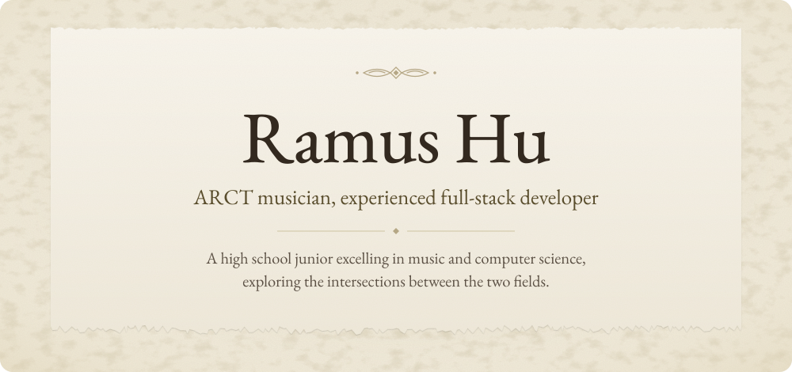
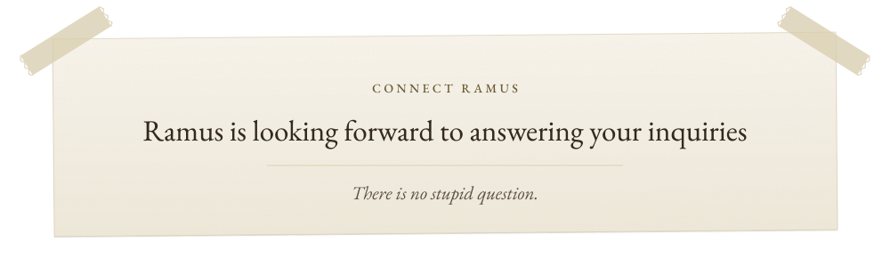

<a href="https://ramushu.vercel.app/"><picture>
  <source media="(prefers-color-scheme: dark)" srcset="assets/hero-dark.svg">
  </picture></a>

<a href="https://ramushu.vercel.app/stem"><picture>
  <source media="(prefers-color-scheme: dark)" srcset="assets/btn-stem-dark.svg">
  </picture></a>
<a href="https://ramushu.vercel.app/music"><picture>
  <source media="(prefers-color-scheme: dark)" srcset="assets/btn-music-dark.svg">
  </picture></a>

<a><picture>
  <source media="(prefers-color-scheme: dark)" srcset="assets/divider-dark.svg">
  </picture></a>

<a><picture>
  <source media="(prefers-color-scheme: dark)" srcset="assets/connect-dark.svg">
  </picture></a>

<a href="mailto:ramushu0410@gmail.com"><picture>
  <source media="(prefers-color-scheme: dark)" srcset="assets/btn-email-dark.svg">
  </picture></a>
<a href="https://www.linkedin.com/in/ramushu/"><picture>
  <source media="(prefers-color-scheme: dark)" srcset="assets/btn-linkedin-dark.svg">
  </picture></a>
<a href="https://instagram.com/ramushu0410"><picture>
  <source media="(prefers-color-scheme: dark)" srcset="assets/btn-instagram-dark.svg">
  </picture></a>

